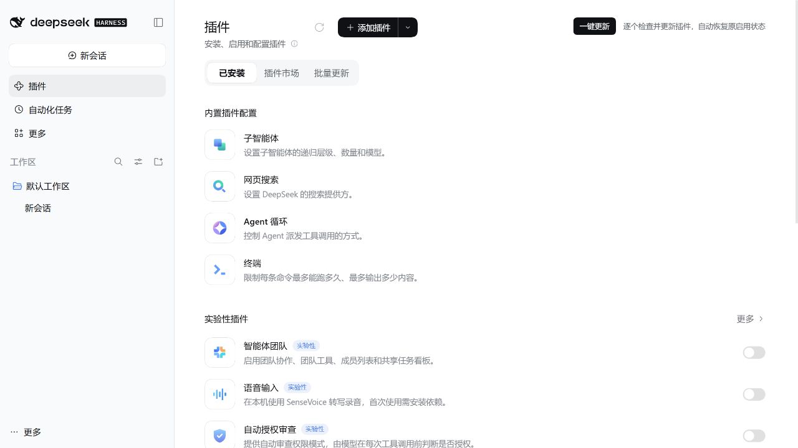
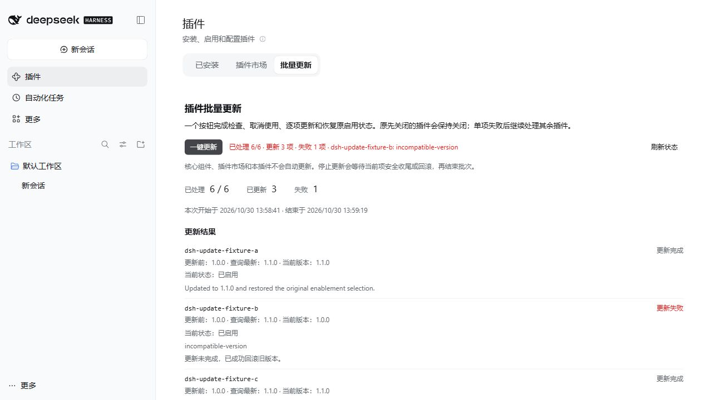

# DSH Plugin Batch Toggle · One-click plugin updates

[](https://github.com/ricardooooooa/dsh-plugin-batch-toggle/actions/workflows/ci.yml)

One **Update all** action in DeepSeek Harness plugin management and dshmarket updates npm-installed plugins serially, temporarily disabling them when needed and restoring their enabled intent. Previously disabled packages stay disabled.

[简体中文](./README.md) · [Changelog](./CHANGELOG.md) · [Report an issue](https://github.com/ricardooooooa/dsh-plugin-batch-toggle/issues)

## Install v0.2.0

Tested runtime: **DSH 0.2.1-rc.5**. Declared compatibility: `>=0.2.1-rc.5 <0.2.2-0`, Node.js 24+.

1. Open **Plugins → Add Plugin** in DSH.
2. Paste the [v0.2.0 prebuilt package URL](https://github.com/ricardooooooa/dsh-plugin-batch-toggle/releases/download/v0.2.0/dsh-plugin-batch-toggle-0.2.0.tgz) below, or download it and enter its absolute file path.
3. Install and enable the plugin. Restart if DSH requests it.

```text
https://github.com/ricardooooooa/dsh-plugin-batch-toggle/releases/download/v0.2.0/dsh-plugin-batch-toggle-0.2.0.tgz
```

No TypeScript or build tools are required. The [GitHub Release](https://github.com/ricardooooooa/dsh-plugin-batch-toggle/releases/tag/v0.2.0) is published. **As of 2026-10-30, the package is not published to npm and no community-catalog PR has been submitted.** Use the release asset above.

Preparation targets the dshmarket community catalog. This tarball-only release will not enter the official Discover index, which requires npm metadata. References below to Discover describe the installed plugin's header action.

Upgrade this plugin through DSH's add/update-plugin flow; it excludes itself from batch updates. For desktop-profile CLI installation, fully exit Desktop and use the CLI bundled with that same rc.5 installation.

## Use

The current interface uses Chinese labels: **一键更新** means Update all, **停止更新** means Stop updates, and **批量更新** opens the detailed view.

Select **一键更新** in Plugins or dshmarket. Each eligible package follows this sequence: check versions → disable if needed → remove the old package → install the update → restore and verify the original enabled intent.

- The interface shows the current item, phase, progress, failure count and per-item results. A definite failure is recorded; processing continues after that item's safe cleanup.
- The same button becomes **停止更新** while running. Stopping waits for the current item to settle or roll back instead of terminating its installation process.
- The native **批量更新** tab shows detailed results and recovery status. The add-plugin menu is another entry point. The detailed tab uses its own action without a duplicate header button.
- Legacy v0.1 recovery records are resumed first. Later runs also prioritize unfinished items from the previous update run.

The shared header covers Installed, Discover and dshmarket tabs. Standalone dshmarket settings/sidebar panels also get the action.

## Scope and limitations

Automatic updates cover **manageable third-party bundles installed from an npm registry under their own package name**. Self, marketplace carriers, official/core bundles, read-only and unmanageable packages are excluded. Git, local file/link, tarball/URL and npm alias sources are skipped. The detailed view explains exclusions.

The queried `latest` is a reference version. Installation uses the official DSH plugin-management SDK and respects its registry configuration, compatibility checks, script approval and `minimumReleaseAge` policy. A new release may not yet be eligible. Results distinguish the previous, queried latest and actually installed versions.

Failed installation or verification triggers a best-effort reinstall of the previous version and restoration of enabled intent. Results and unfinished items persist in `.dsh-plugin-batch-toggle/` within the active profile and survive a restart. **Rollback is not a complete undo:** third-party scripts, data changes and runtime effects may remain. Failed rollback remains an outstanding recovery item. Resolve unfinished work before uninstalling this plugin.

Other known limits:

- Restart requirements are displayed; the plugin does not restart DSH automatically.
- DSH's enable API appends restored bundles, so the complete original interleaving and configuration precedence with preserved bundles cannot be guaranteed.
- Previously disabled internal Cordis rows are not force-enabled.
- Header integration depends on DOM markers. If host markup changes, use the native tab or menu.

Endpoints use DSH owner authentication and same-origin checks. There is no extra listener or model-key requirement. This plugin does not upload conversations; package lookup and installation contact the configured npm registry.

## Screenshots

All screenshots use an **isolated rc.5 test profile**. The `dsh-update-fixture-*` packages in the results are controlled-registry fixtures, not evidence that every community plugin has been tested.

**Plugin management:** one shared header action for Installed, Discover and the marketplace.



**dshmarket:** the same action remains available alongside the marketplace's own update control.


**Detailed results:** fixture B fails and rolls back; later fixtures continue. The detailed tab has no duplicate header action.



## Development and validation

```powershell
./tooling/bootstrap.ps1
./tooling/pnpm.ps1 run check
./tooling/pnpm.ps1 run release:pack
./tooling/pnpm.ps1 run test:integration:updates
```

Local validation on 2026-10-30 passed type checking, 108 automated tests, frontend/backend builds and a real rc.5 controlled-registry integration: A/C/D updated, B failed and rolled back, later items continued, and previously disabled D stayed disabled without executing. Tests use an isolated profile and do not run updates against the user's normal plugin collection. See [validation scope and boundaries](./docs/VALIDATION.md).

[Release notes](./docs/RELEASE.md) · [Marketplace submission preparation and PR draft](./docs/marketplace-submission.md) · [Current design](./docs/superpowers/specs/2026-10-30-rc5-one-click-update.md) · [MIT License](./LICENSE)
