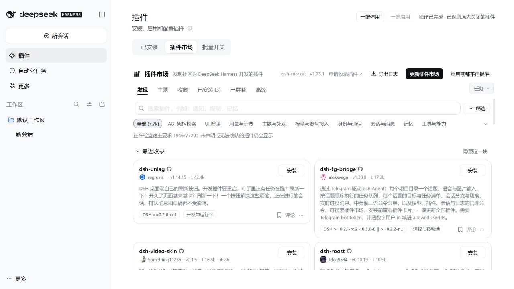

# DSH Plugin Batch Toggle · 插件一键停用与恢复

更新插件前，一键暂停当前开启的第三方插件；更新后，一键恢复原来的启用列表。原先关闭的插件继续保持关闭。

[English](./README.en.md)



## 使用效果

- 插件管理、官方 Discover 标签和 dshmarket 标签的页头显示 **一键停用 / 一键启用**。
- dshmarket 独立设置或侧栏面板顶部也显示相同按钮。
- 原生 **批量开关** 标签页提供进度、逐项结果、待恢复插件及重启提示；“添加插件”菜单也提供入口。
- 停用前保存当前 profile 的恢复记录。重启 DSH 后仍可继续恢复。
- 跳过核心/只读组件、市场载体及本插件，保留恢复入口。每轮恢复完成后才允许开始下一轮停用。

## 安装

在 DSH 的“插件 → 添加插件”中填写以下预编译安装包链接：

```text
https://github.com/ricardooooooa/dsh-plugin-batch-toggle/releases/download/v0.1.0/dsh-plugin-batch-toggle-0.1.0.tgz
```

也可从 [Releases](https://github.com/ricardooooooa/dsh-plugin-batch-toggle/releases/latest) 下载后，在添加插件入口填写安装包绝对路径。若选择命令行安装到桌面 profile，请先完全退出 DSH 桌面端，并使用桌面端随附 CLI，避免全局 CLI 版本或 desktop profile 限制。下面以安装在 C:/dsh 为例，按实际位置调整：

```powershell
& 'C:/dsh/resources/runtime/cli/bin/dsh.cmd' plugin --profile desktop add 'https://github.com/ricardooooooa/dsh-plugin-batch-toggle/releases/download/v0.1.0/dsh-plugin-batch-toggle-0.1.0.tgz'
```

在插件管理中启用本插件。若 DSH 提示需要重启，重启后进入插件管理或市场即可看到按钮。安装包自带构建产物，不需要用户安装 TypeScript 或构建工具。npm 发布后才可使用包名安装；当前请使用上面的 GitHub Release 安装包。

## 使用

1. 点击 **一键停用**。等待本轮完成，查看失败项或重启提示。
2. 按市场原有流程更新需要更新的插件。
3. 点击 **一键启用**，恢复本轮停用前开启的插件。

恢复失败的项目保留在待恢复列表，可再次点击启用；已卸载的包不会被重新安装。批停不主动切换模型账号、不调用模型，也不自动安装、更新或重启 DSH。

## 兼容范围与限制

- 声明范围：DSH `>=0.2.1-rc.3 <0.2.2-0`，Node24+。运行验收基线为 rc.3；rc.5 相关接口源码比对一致，未单独完成其运行验收。
- 官方管理页使用原生插槽作为稳定入口。页头按钮采用 DOM 兼容层；DSH 或 dshmarket 改变结构时，原生“批量开关”标签和菜单仍可使用。
- 官方启用 API 会把恢复的包追加到启用列表末尾。本插件按记录中的目标顺序恢复，不能保证与保留包交错的完整配置层顺序原样复原。
- 管理当前 profile 的 bundle 开关，不强开包内原先关闭的 Cordis 插件项。
- 第三方清理若卡住，官方 API 没有安全取消参数。界面保持进行中，不并发叠加操作；重启后根据持久记录恢复。

## 数据与权限

恢复状态仅保存在当前 profile 目录的 `.dsh-plugin-batch-toggle/`。接口通过 DSH 现有 Owner 认证与同源校验，不额外开放端口。没有遥测、远端上传或模型密钥需求。卸载本插件前建议先完成待恢复操作。

## 开发

开发者先修改 `config/development.json`，使桌面程序和随附 CLI 路径匹配自己的安装位置；该文件不进入用户安装包。下面的开发命令只在项目隔离目录测试。

```powershell
./tooling/bootstrap.ps1
./tooling/pnpm.ps1 run check
./tooling/pnpm.ps1 run release:pack
./tooling/pnpm.ps1 run test:integration
```

集成测试仅操作项目 `.dev/integration` 内的独立 profile，验证鉴权、真实 HMR 停用及进程重启后的恢复。测试不连接日常 desktop profile 或真实模型账户。

[发布与社区收录指南](./docs/RELEASE.md) · [设计依据](./docs/superpowers/specs/2026-10-30-batch-plugin-design.md)

MIT License.
